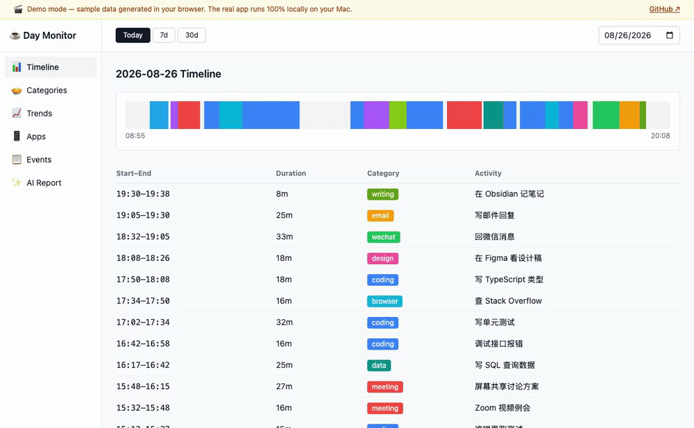
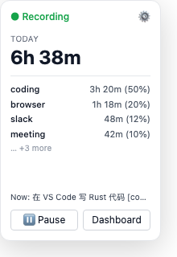
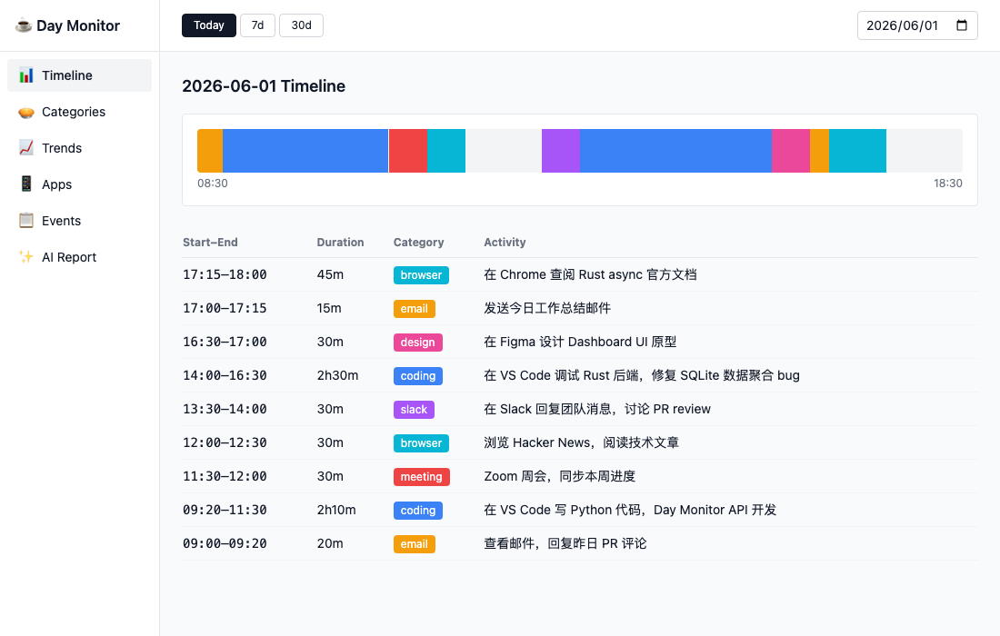
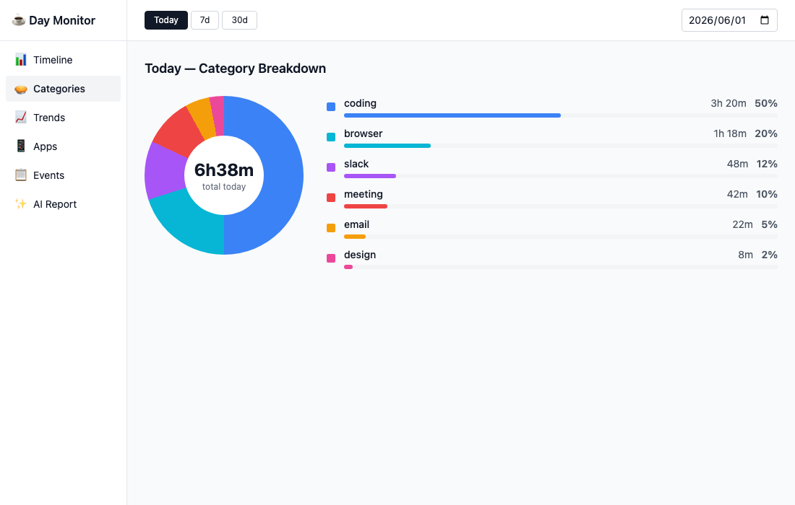
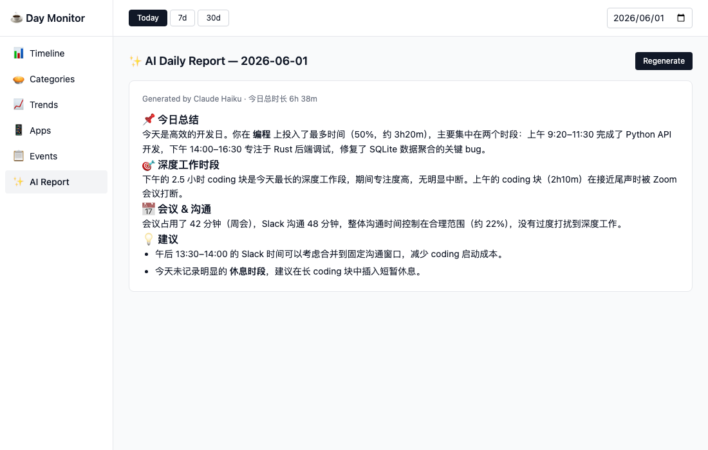

# Day Monitor

> macOS 菜单栏小工具：自动追踪你一天的工作内容，本地分析后生成可视化日报。

每 ~20 秒截一次屏 → Claude Haiku 识别活动类型 → SQLite 记录 → 仪表板展示时间轴/分类/趋势/AI 日报。

[](https://github.com/Defiabell/day-monitor/releases/latest)
[](LICENSE)

[](https://github.com/Defiabell/day-monitor/releases)

**🎬 在线 Demo（浏览器直接打开，示例数据）：https://defiabell.github.io/day-monitor/**



[English](README.md) | 简体中文

## 截图预览

**菜单栏 Popover** — 随时查看今日进度，一键暂停或跳转 Dashboard：



**Dashboard · Timeline** — 全天时间轴 + 活动明细表：



**Dashboard · Categories** — 分类占比环形图 + 进度条：



**Dashboard · AI Report** — Claude 生成的每日工作分析报告：



## 这个项目能做什么

- 🕐 **自动追踪时间** — 不需要手动开关 timer
- 🤖 **AI 识别活动** — Claude 看截图直接告诉你"在 VS Code 写代码"或"在微信回消息"
- 📊 **可视化** — 时间轴、分类饼图、跨日趋势、应用排行
- 💰 **可控成本** — 内置 token / 费用统计 + 月度预算上限，避免 API bill 失控
- 🔒 **隐私本地** — 截图不入库（只存 hash 和文字描述），数据全在本机

## 系统要求

- **macOS 12+**（Release 为 universal 包，主要在 Apple Silicon 上测试）
- **Anthropic API Key** ([注册](https://console.anthropic.com)，新用户有 $5 免费额度)，**或**任何兼容 Anthropic 的端点（含本机模型）——见[换成你自己的模型](#换成你自己的模型或完全本地跑)

## 快速开始

**最简单：[到 Releases 下载预编译包](https://github.com/Defiabell/day-monitor/releases/latest)**（`.dmg` 或 `.zip` 均可，universal 二进制）。首次打开会被 Gatekeeper 拦下——右键点图标 → 打开，再点一次「打开」即可；这个包没有做苹果公证。

**Homebrew：**

```bash
brew tap defiabell/tap
brew install --cask day-monitor
```

**自己编译：**

```bash
git clone https://github.com/Defiabell/day-monitor
cd day-monitor

# Rust 工具链
curl --proto '=https' --tlsv1.2 -sSf https://sh.rustup.rs | sh -s -- -y

# 前端依赖
cd app && yarn install

# 开发模式
yarn tauri dev

# 打包发布
yarn tauri build
# 产物：app/src-tauri/target/release/bundle/macos/Day Monitor.app
```

## 架构

```
┌────────────────────────────────────────────────┐
│  Day Monitor.app  (Tauri 2 / Rust + React)      │
│                                                   │
│  Menu Bar ──click──> Popover (200×300)          │
│      │                                           │
│      ├──> Dashboard (1100×700, 6 views)         │
│      └──> Settings (interval, budget, etc.)     │
│                                                   │
│  Rust Backend                                    │
│   ├─ tokio loop: capture → hash → analyze       │
│   ├─ /usr/sbin/screencapture (native, no Python)│
│   ├─ Claude Haiku via reqwest                   │
│   └─ rusqlite (~/.day-monitor/monitor.db)       │
└────────────────────────────────────────────────┘
```

## 项目结构

```
day-monitor/
├── app/                          # Tauri app
│   ├── src/                       # React + TypeScript frontend
│   │   ├── popover/               # 菜单栏 popover
│   │   ├── dashboard/             # 6 个视图
│   │   ├── settings/              # 设置窗口
│   │   └── lib/                   # 共享类型 + invoke 包装
│   └── src-tauri/src/             # Rust backend
│       ├── lib.rs                 # 入口、tray、窗口管理
│       ├── loop_runner.rs         # tokio 监控循环
│       ├── capture.rs             # 截屏 + 感知哈希
│       ├── analyze.rs             # Claude API 调用
│       ├── db.rs                  # SQLite 读写
│       ├── stats.rs               # 数据聚合
│       ├── report.rs              # AI 日报生成
│       ├── settings.rs            # 用户配置
│       └── commands.rs            # Tauri commands
├── dist/                          # 发布包（zip + 安装脚本 + 用户文档）
├── docs/                          # 设计文档
├── LICENSE                         # MIT
├── PRIVACY.md                      # 隐私政策
└── README.md                       # 英文版说明
```

## 配置项

进 Settings 窗口可调：

| 项 | 默认 | 说明 |
|----|------|------|
| 采集间隔 | 20s | 越短数据越细，越长越省钱 |
| 截图分辨率 | 640px | 影响 token 成本（直接 ~50%）|
| 去重阈值 | 12 | 屏幕几乎没变就跳过，0~20 |
| 数据保留 | 30 天 | 老数据自动清理 |
| 月度预算 | 0 (无限) | 超限自动暂停 API 调用 |
| 隐私黑名单 | 1Password、Keychain Access | 命中的应用**连截图都不拍** |
| 模型端点 | 空（官方 API） | 填了就完全不走 claude CLI，见下节 |
| 模型 ID | 空（claude-haiku-4-5） | 自定义端点上填对方的模型名 |

## 换成你自己的模型（或完全本地跑）

Settings 窗口 → **模型端点**。留空 = 官方 Anthropic API，行为和以前完全一样。填上地址后，所有请求都发到你填的地方，**并且会完全跳过内置的 `claude` CLI 路径**——不存在悄悄回落到 Anthropic 的可能。

任何能响应 `POST /v1/messages` 的服务都可以：

| 用法 | 端点 | 模型 |
|------|------|------|
| 本地，一点不出本机 | `http://localhost:11434` | `qwen2.5vl:7b`（任意视觉模型）|
| 网关（LiteLLM / OpenRouter 等）| 你的网关地址 | 网关上有的模型 |
| 官方 API（默认）| *留空* | *留空* |

几点说明：

- **本地必须用视觉模型**：程序发的是图片，纯文本模型会直接失败。[ollama](https://ollama.com) 从 v0.14 起原生支持 Anthropic Messages API。
- 地址写法很宽松：`host`、`host/`、`host/v1`、`host/v1/messages` 四种都能正确解析。
- 自定义端点会同时带上 `x-api-key` 和 `Authorization: Bearer`，因为各家兼容实现认的头不一样。
- **付费端点记得填单价**：月度预算是拿 token 数 × 单价算出来的。自定义端点上单价留空按**免费**处理——这对本地模型是对的，对付费网关是错的。

## 隐私 & 数据安全

> **一句话：记录数据全部存在你本机，作者拿不到任何数据。默认情况下唯一离开本机的是截图本身（发给 Anthropic 做识别）；换成本地模型后，一点都不出本机。**

| 数据项 | 存储位置 | 说明 |
|--------|---------|------|
| 截图本身 | ❌ 不存储 | 只在 RAM 里处理，分析完立即丢弃 |
| 感知哈希 | `~/.day-monitor/monitor.db` | 用于去重，无法还原图片 |
| 活动描述 | `~/.day-monitor/monitor.db` | 一句话文字，如"在 VS Code 写代码" |
| API Key | `~/.day-monitor/.env` | 只在本机，从不上传 |
| AI 日报 | `~/Documents/day-monitor/` | 纯本地文件 |

**数据流向：**

```
屏幕截图 → RAM 处理 → Anthropic Claude API（识别活动）→ 文字描述写入本地 SQLite
                 ↓
           截图立即丢弃（不落盘）
```

- **本项目作者** 收不到你的任何数据（无 telemetry，完全开源可审计）
- **Anthropic** 会收到压缩后的截图用于识别，适用其[隐私政策](https://www.anthropic.com/privacy)。这是唯一一步会离开本机的操作，**可以彻底去掉**——见[换成你自己的模型](#换成你自己的模型或完全本地跑)
- **黑名单里的应用连截图都不会拍**：判定发生在截屏之前，所以根本不存在「拍了但没发」的数据。黑名单启用时如果识别不出前台应用，这一轮直接跳过而不是猜
- 随时 `rm -rf ~/.day-monitor` 可彻底删除所有本地数据

详见 [PRIVACY.md](PRIVACY.md)。

## 开发 & Mock 数据

本地开发时可以用脚本快速填充 7 天的模拟数据，无需跑满一周：

```bash
# 初始化 mock 数据（不覆盖已有数据）
python3 scripts/seed_mock_data.py

# 重置并重新生成（--days 控制天数）
python3 scripts/seed_mock_data.py --reset --days 30
```

数据写入 `~/.day-monitor/monitor.db`，启动 App 后即可看到有数据的 Dashboard。在线 Demo 就是同一个 Dashboard 在浏览器里运行、数据层换成了生成的示例（[app/src/lib/mockApi.ts](app/src/lib/mockApi.ts)）。

## 常见问题

### 这不就是 macOS 自带的「屏幕使用时间」吗？

屏幕使用时间回答的是**哪个应用**在前台，Day Monitor 回答的是**你在那个应用里干什么**。同样是 Cursor 前台两小时，屏幕使用时间给你「Cursor — 2 小时」，Day Monitor 把这两小时拆成「写 React 组件」「调接口报错」「看 diff 改 bug」，并且按**活动**归类——活动分类是跨应用可比的：在终端里写代码和在 IDE 里写代码算同一类，而看着 AI 代理干活和自己敲代码算两类。最终产出是一份当天的文字复盘，不是一张按应用名排的柱状图。

### 截图会被发到哪里去？

默认会发给 Anthropic 做识别，除此之外不发去任何地方。这是唯一一步离开本机的操作，也是「拿到一句描述」而不是「拿到一个应用名」的代价。不接受这个交换的话，[改成本地模型](#换成你自己的模型或完全本地跑)，就一点都不出本机。两种模式下作者都收不到任何数据。

### 截图会存在硬盘上吗？

不会。图片只在内存里待到识别完就丢弃。落到 SQLite 里的是：时间戳、一句话描述、分类、应用名，以及一串用来判断画面有没有变的感知哈希——哈希还原不成图片。

### 能让它对某些应用完全瞎掉吗？

能。黑名单的判定发生在**截屏之前**，命中的应用根本不会被拍，所以没有「可发送」的数据存在。默认就带 1Password 和 Keychain Access。黑名单启用时如果识别不出前台是谁，这一轮直接跳过而不是猜。

### 一天大概花多少钱？

默认配置（20 秒间隔、640px、开去重）下，用 Claude Haiku 一个正常工作日大约在几毛钱人民币的量级。面板里有实时的 token 和花费统计，月度预算超了会硬停 API 调用。用本地模型则完全免费。

### 没有 Anthropic 账号能用吗？

能。用 ollama 跑本地视觉模型，或者接你已有的任何网关，见[换成你自己的模型](#换成你自己的模型或完全本地跑)。

### 支持 Windows / Linux 吗？

暂时不支持。截屏层和菜单栏集成都是 macOS 专有的。要求 macOS 12+，发布的是 universal 二进制。

### 不用了以后数据怎么办？

全部在 `~/.day-monitor/` 下面，删掉这个目录就干净了（数据库、配置、缓存的日报）。没有账号，服务端也没有任何副本。

## 贡献

欢迎 PR。关注的方向：

- Intel Mac (x86_64) 支持（universal binary）
- Linux / Windows 支持（需要替换 screencapture）
- 多 LLM 后端（OpenAI、ollama 本地模型）
- i18n（当前 prompt 和 UI 都是中文）
- 更细粒度设置（工作时段、低电量暂停）

## 许可证

MIT License — 见 [LICENSE](LICENSE)。
